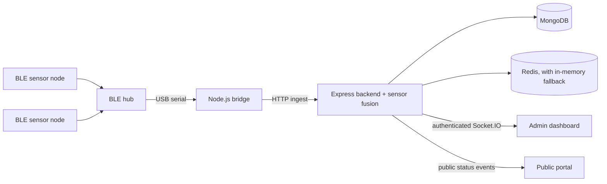

# ASSET 2.1 — BLE Forest-Fire Early-Warning System

ASSET is an early-warning prototype that collects smoke, temperature, and humidity readings from outdoor sensor nodes over Bluetooth Low Energy (BLE). A hub forwards the readings to a local PC backend, where a sensor-fusion service evaluates fire conditions and sends real-time updates to the protected admin dashboard and the public status portal.

> **Project status:** Prototype. Field calibration and hardware validation are still required before operational use. See [Known limitations](#known-limitations).

## System architecture



- **Sensor nodes** (`iot/asset_node_ble`, `iot/asset_node2_ble`): Deneyap/ESP32-S3 boards with an MQ-2 smoke sensor, DHT11 temperature/humidity sensor, and a local buzzer/LED alarm output.
- **Hub** (`iot/asset_hub_ble`): Collects BLE node packets and forwards them to the PC over USB serial.
- **Bridge** (`backend/bridge/bridge.js`): Reads serial packets, validates the packet CRC, and sends accepted readings to the backend. It can use a detected serial hub or run in mock mode.
- **Backend** (`backend/`): Express API, MongoDB persistence, optional Redis cache, sensor fusion and alert handling, and Socket.IO event delivery.
- **Admin dashboard** (`backend/public/admin.html`): Authenticated node monitoring, alert, and threshold-management interface.
- **Public portal** (`backend/public/index.html`): Displays a limited fire-status summary. It does not receive node identifiers or sensor measurements.

## Hardware

| Component | Role |
|---|---|
| Deneyap Kart 1A v2 (ESP32-S3) | One board per node and one for the hub |
| MQ-2 smoke sensor | Analog smoke reading at A0 |
| DHT11 sensor | Temperature and humidity at D4 |
| IRF5210 MOSFET | Buzzer/LED alarm output; 3.3 V gate drive requires validation |
| 18650 or equivalent cell | Node power; real battery measurement is not implemented yet |
| PC | Runs the Node.js backend and bridge; MongoDB is required, Redis is optional |

See [`docs/ASSET_2.0_PINOUT.md`](docs/ASSET_2.0_PINOUT.md) and [`docs/ASSET_2.0_PINOUT_V2.md`](docs/ASSET_2.0_PINOUT_V2.md) for pin assignments and wiring notes. Firmware changes require hardware testing; the firmware is maintained separately from routine software changes.

## Quick start

### Requirements

- Node.js and npm
- MongoDB
- Redis is optional; the backend has an in-memory fallback
- A supported USB serial hub for live hardware mode

### Configure and run

```bash
# Install backend dependencies
cd backend
npm install

# Create and configure a local environment file from the template
cp .env.example .env
# Set the required local values in .env, including database and API keys.

# Return to the repository root, then start the backend and bridge
cd ..
./asset-control.sh start
./asset-control.sh status
```

The control script starts the backend and selects live serial mode when it detects a single supported hub. If no hub is detected, it starts the bridge in mock mode. Ambiguous or failed live-hub startup is reported; the script does not silently switch a failed hardware connection to mock mode.

Stop the processes started by the script with:

```bash
./asset-control.sh stop
```

Open the local interfaces:

- Admin dashboard: `http://localhost:5000/admin` — requires a valid `ADMIN_API_KEY`.
- Public portal: `http://localhost:5000/`.

### Run components manually

```bash
# Terminal 1: backend
cd backend && npm run dev

# Terminal 2: live bridge
cd backend && node bridge/bridge.js

# Or run a mock data stream without the hub
cd backend && node bridge/bridge.js --mock
```

## Configuration

Use `backend/.env.example` as the template for local configuration. The real `.env` file is machine-specific and must not be committed.

| Variable | Purpose |
|---|---|
| `PORT` | Backend HTTP port; defaults to 5000 |
| `MONGODB_URI` | MongoDB connection string |
| `REDIS_URI` | Optional Redis connection string |
| `INGEST_API_KEY` | Authenticates bridge-to-backend sensor ingestion |
| `ADMIN_API_KEY` | Protects admin API routes and the admin Socket.IO connection |
| `JWT_SECRET` | Used by legacy-compatible authentication routes |
| `ALLOWED_ORIGINS` | Allowed browser origins for cross-origin requests |
| `NODE_ENV` | Runtime mode; simulation endpoints are disabled in production |
| `FIREBASE_*`, `TWILIO_*` | Reserved for notification integrations; not currently active |

Never place real keys or credentials in source files, documentation, URLs, or public issue reports.

## Security and data flow

- Sensor ingestion requires the `x-api-key` request header.
- Admin API routes and the admin Socket.IO connection require admin authentication.
- Simulation endpoints are disabled when `NODE_ENV=production`.
- The public portal receives only a limited aggregate fire-status event; detailed sensor data remains on the protected admin channel.

## Known limitations

1. **Wireless threshold synchronization:** Battery-powered nodes do not yet receive threshold updates wirelessly.
2. **Battery measurement:** `readBatteryPct()` currently returns a fixed value; voltage measurement and battery-curve calibration remain to be implemented.
3. **Notifications:** Email, SMS, and voice-call notifications are not implemented.
4. **MQ-2 calibration:** Smoke thresholds require field calibration under real outdoor conditions.
5. **MOSFET validation:** The IRF5210 may not fully switch at a 3.3 V gate drive; validate it under the actual buzzer/LED load.
6. **3D enclosure fit:** The v2 enclosure drawings include assumptions that must be checked against measured hardware before fabrication.

## 3D files

- `3d_files/asset-aydem-v1/` contains the earlier capsule model and reference STL.
- `3d_files/asset-aydem-v2/` contains the v2 node enclosure sources and exported STL files, plus a hub enclosure draft. Review the folder README and verify all marked assumptions against the physical hardware before fabrication.

## Repository structure

```text
assetaydem/
├── backend/       # Express API, bridge, fusion services, and web interfaces
├── iot/           # BLE node and hub firmware
├── docs/          # Hardware and project documentation
├── 3d_files/      # OpenSCAD sources and STL exports
├── asset-control.sh
└── README.md      # Primary project documentation (English)
```

## Documentation

- [`docs/ASSET_2.0_PINOUT.md`](docs/ASSET_2.0_PINOUT.md) and [`docs/ASSET_2.0_PINOUT_V2.md`](docs/ASSET_2.0_PINOUT_V2.md) — hardware pinout and wiring references.
- [`docs/PROJECT_HANDOVER.md`](docs/PROJECT_HANDOVER.md) — project handover and history.

## Releases

No GitHub release has been published yet. The proposed first release version is `v2.1.0`; release tags and artifacts have not been created.

## License

ASSET is licensed under the [Apache License 2.0](LICENSE).

Copyright 2026 Muhammedşah Fidan.
