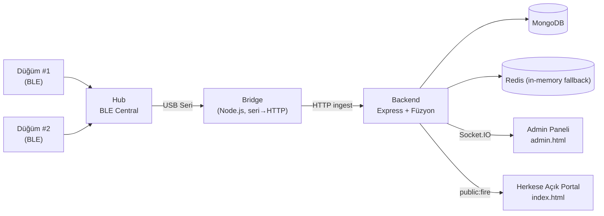

# ASSET 2.1 — Sahada Yangın Erken Uyarı Sistemi (BLE Düğüm → Hub → PC Köprü → Backend)

ASSET, açık alanda konumlanan düşük maliyetli sensör düğümlerinin (MQ-2 duman + DHT11 sıcaklık/nem) bir BLE hub üzerinden merkezi bir backend'e raporlandığı yangın erken uyarı prototipidir. Backend, düğüm verilerini füzyon motoruyla değerlendirir; yangın alarmı oluştuğunda yönetici paneline canlı bildirim gönderir ve herkese açık Portal'da yangın durumu yayınlanır.

## Mimari (v2)



- **Düğüm** (`iot/asset_node_ble`, `iot/asset_node2_ble`): MQ-2 duman (A0, 10k:10k bölücü), DHT11 (D4), aktif-düşük sürüş için IRF5210 (D1) ile alarm çıkışı (buzzer/LED), BLE üzerinden 5 sn'de bir ölçüm yayını.
- **Hub** (`iot/asset_hub_ble`): BLE Central; düğüm paketlerini toplar, USB seri port ile PC'ye aktarır.
- **Bridge** (`backend/bridge/bridge.js`): seri portu dinler, 13B paket + CRC8 doğrulamasıyla backend HTTP ingest uçlarına yollar; backend'deki eşik değişikliklerini canlı Socket.IO ile takip eder (koruma: `ADMIN_API_KEY` handshake doğrulaması).
- **Backend** (`backend/`): Express API, MongoDB kalıcılık, Redis önbellek (kurulu değilse in-memory fallback), Socket.IO kanalı (handshake auth + admin/public oda ayrımı), Füzyon/Alarm/Bildirim servisleri.
- **Yönetim Paneli** (`backend/public/admin.html`): eşik konfigürasyonu, düğüm izleme, alarm geçmişi.
- **Portal** (`backend/public/index.html`): herkese açık yangın durumu sayfası (sayfa güncellemesi Socket.IO `public:fire` özetiyle; düğüm ID/ölçüm detayları public istemciye gitmez).

## Donanım Gereksinimleri

| Parça | Not |
|---|---|
| Deneyap Kart 1A v2 (ESP32-S3) | Düğüm başına 1 + Hub için 1 |
| MQ-2 duman sensörü | Analog A0 (düğümlerde) |
| DHT11 sıcaklık/nem | D4 (düğümlerde) |
| IRF5210 (TO-220) | Buzzer/LED alarm çıkışı, aktif-düşük sürüş |
| Pil hücresi (18650 vb.) | Gerçek voltaj ölçümü A1 bölücüsüyle planlı; bkz. Bilinen Sınırlar |
| PC | Node.js + MongoDB; seri port için `dialout` grubu üyeliği |

Firmware pin dağılımı için `docs/ASSET_2.0_PIN_SEMASI.md` ve `docs/ASSET_2.0_PIN_SEMASI v2.md` dosyalarına bakın (BOM, pinler, aktif-düşük alarm topolojisi).

> Firmware (`iot/`) bu projede **sabit** kabul edilmeli: değişiklikler sahada donanım
> testi gerektirir. Katkıda bulunacaksanız lütfen bu sınırı gözetin.

## Kurulum ve Çalıştırma

```bash
# 1) bağımlılıklar
cd backend && npm install

# 2) ortam dosyası (örneği kopyalayıp değerleri kendi ortamınızda doldurun)
cp .env.example .env
#  .env'i düzenleyin; .env repoya girmez (gitignore).

# 3) sık kullanmak için: backend + bridge'i tek komutla başlat
#    (repo kökünde, backend'den değil)
./asset-control.sh start          # hub bağlıysa canlı seri, değilse --mock
./asset-control.sh status
./asset-control.sh stop
```

`asset-control.sh start` Çalışma modu seçimi:

| Durum | Davranış |
|---|---|
| Hub tespit edildi (Auto-detect: `ttyUSB*`/`ttyACM*` yolu veya VID `10c4`) ve açıldı | Bridge canlı seri modda |
| Hub yok | Bridge `--mock` (5 sn'de simüle paket) |
| Hub adayı birden çok | Rastgele seçim YAPILMAZ; adaylar listelenir, `--port=/dev/ttyX` ile açık seçim ister (exit 7) |
| Hub açık başlatıldı ama açılış onayı gelmedi | Hata bildirilir; **mock'a sessiz geçiş yok** (exit 9) |

Şeffaflık: `start/stop` yalnızca script'in kendisinin başlattığı ve pid dosyasına kaydettiği süreç gruplarını durdurur; sistemde önceden çalışan süreçlere / port sahipliğine dokunmaz; anahtarları script'e sabitlemez/yazdırmaz (env yüklemesini süreçlerin kendi yapar).

### Manuel 3 komut (script'siz)

```bash
# Terminal 1
cd backend && npm run dev        # backend :5000

# Terminal 2 (gerçek donanım)
cd backend && node bridge/bridge.js

# Terminal 2 (Donanımsız test)
cd backend && node bridge/bridge.js --mock
```

- Yönetim paneli: `http://localhost:5000/admin`
- Herkese açık portal: `http://localhost:5000/`

## Konfigürasyon (Ortam Değişkenleri)

`backend/.env.example` örnek dosyasıdır; repoya gerçek `.env` girmez. Yalnızca **değişken adları**:

| Değişken | Amaç |
|---|---|
| `PORT` | HTTP dinleme portu (varsayılan 5000) |
| `MONGODB_URI` | MongoDB bağlantısı |
| `REDIS_URI` | Redis bağlantısı (yoksa in-memory fallback) |
| `INGEST_API_KEY` | Bridge → backend HTTP ingest doğrulaması |
| `ADMIN_API_KEY` | Yönetim uçları ve Socket.IO admin handshake doğrulaması |
| `JWT_SECRET` | Kimlik doğrulama servisleri (geriye dönük uyumluluk uçları) |
| `ALLOWED_ORIGINS` | CORS izin listesi |
| `NODE_ENV` | `development` / `production` |
| `FIREBASE_*`, `TWILIO_*` | Bildirim entegrasyonları (şu an **aktif olarak kullanılmıyor**) |

## Test ve Güvenlik Notları

- Testte geçici env değerleri `.env`'e değil, komuta verilir; örn. `ADMIN_API_KEY=... npm run dev`.
- Socket.IO kanalı admin handshake anahtarı olmadan korumalı olayları almaz; yanlış anahtar durumunda yönetim panelinde modal tabanlı kurtarma akışı vardır.
- Backend sağlık ucu: `GET /api/health`.
- Herkese açık ve korumsız akış yalnız `public:fire` özetidir (`fireActive`, `fireAlertZoneCount`).

## 3D Dosyaları

- `3d_files/asset-aydem-v1/` — v1 örnekçi düğüm kapsülü (OpenSCAD kaynağı + referans STL).
- `3d_files/asset-aydem-v2/` — v2. **Önemli:** v2 kaynaklarında TASLAK/DOĞRULANMADI
  işaretli parametreler vardır (özellikle pil bölmesi gibi); üretime almadan önce bu
  parametreleri gerçek donanım ölçüleriyle doğrulayın. Ayrıntılar klasördeki README'de.

## Bilinen Sınırlar / Açık İşler

1. **Kablosuz eşik senkronizasyonu yok:** Pil ile çalışan düğümler backend'deki eşik değişikliklerini kablosuz alamaz (hub üzerinden kanal kurulmalı).
2. **Pil yüzdesi simüle:** `readBatteryPct()` sabit değer döndürür; gerçek Li-Ion gerilim eğrisi A1 bölücü ölçümüyle hesaplanmalı.
3. **E-posta/SMS/push bildirimleri kodlanmadı:** FCM altyapısı mevcut ancak henüz entegre edilmedi.
4. **MQ-2 saha kalibrasyonu yapılmadı:** temiz hava baz ADC değeri kalibrasyonu gerekli.
5. **IRF5210 mantık seviyesi doğrulanmadı:** 3.3V gate sürüşü sınırda; yük altında ölçüm bekliyor.

## Depo Yapısı

```
assetaydem/
├── backend/            # Express API + füzyon + bridge + public sayfalar
│   ├── src/            # routes, controllers, services, socket, middleware, utils
│   ├── public/         # admin.html, index.html
│   ├── bridge/         # bridge.js (seri↔HTTP köprü)
│   └── scripts/        # senaryo/sim komutları
├── iot/                # ESP32/BLE firmware (asset_node_ble, asset_node2_ble, asset_hub_ble)
├── docs/               # PIN şemaları, devir-teslim dokümanı, fotoğraflar
├── 3d_files/           # v1 + v2 OpenSCAD kaynakları ve STL dışa aktarımı
├── asset-control.sh    # tek komut start/stop/status
├── BURADAN_BASLA.md    # hızlı giriş + açık işler
└── AGENTS.md           # (geliştirici yardımcı çalışma kuralları)
```

## Sürümler / Releases

Releases henüz oluşturulmadı. Önerilen ilk yayın düzeni: `vX.Y.Z` etiket şemasıyla
ilk etiket `v2.1.0`; release asset olarak 3D STL dışa aktarımları eklenebilir.
Etiket/release/push işlemleri kullanıcıya aittir.

## Dokümanlar

- `BURADAN_BASLA.md` — hızlı giriş + mimari + açık işler listesi
- `docs/ASSET_2.0_PIN_SEMASI.md`, `docs/ASSET_2.0_PIN_SEMASI v2.md` — donanım pinleri ve BOM
- `docs/PROJE_DEVIR_TESLIM.md` — nesil ayrımı ve devir-teslim notları

## Lisans

Bu proje **Apache License 2.0** ile lisanslanmıştır — tam metin için
[`LICENSE`](LICENSE) dosyasına bakın.

Telif hakkı satırındaki `[COPYRIGHT HOLDER]` yer tutucusu, kullanıcının
resmî adı ile değiştirilmelidir (proje metadata'sında açık sahibi belirtilmediği
için bilinçli olarak yer tutucu bırakılmıştır).
